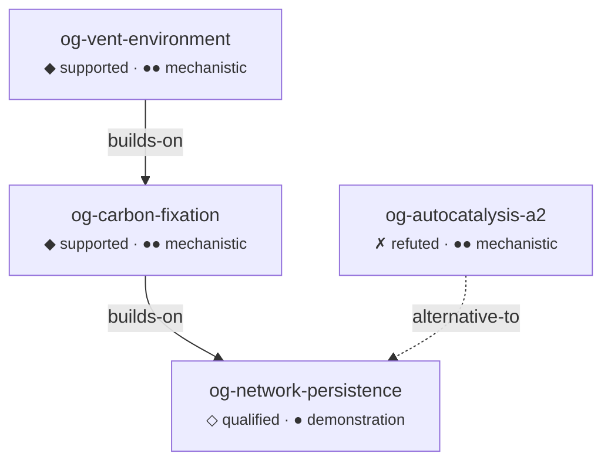

---
tags:
  - investigation
  - study
---

# Investigations

A single [study](studies.md) answers one question. An **investigation** is the
argument several studies build together — a named collection of studies under one
research question, wired into a gated DAG that accumulates into a defensible
claim.

## Investigation ≡ branch ≡ worktree

An investigation is not just a folder of studies. It is a **1:1:1 identity**: the
slug is also a git branch name and a git worktree directory.

```
investigations/<slug>/investigation.yaml   # the collection + its narrative spine (lists members by slug)
investigations/<slug>/reports/              # the rendered per-investigation report
studies/<slug>/study.yaml                   # member studies live FLAT at the workspace root
```

Member studies are **not** nested inside the investigation directory — they live flat at
`studies/<slug>/`, and `investigation.yaml` references them by slug. Nesting a `study.yaml`
under `investigations/**/` is a deliberate hard **L0** audit violation (`no-nested-study`);
the flat layout is what the reproducibility contract mandates.

The `/viva-investigation` skill makes this concrete:

- **`new`** writes `investigation.yaml`, creates the branch, and commits — no push.
- **`open`** materializes a **worktree** at `<ws>/.pbg/worktrees/<slug>/` with its
  own dashboard server (its own `.pbg/composite-runs.db`, its own ports).

This is why parallel agents never trample each other: one investigation, one
branch, one worktree, one server. An investigation is the unit of a branch and a
draft PR — the natural boundary at which a line of work is proposed, reviewed, and
merged. (Merges are always a human call; the tooling never auto-merges.)

??? note "Reproducibility follows the branch"
    Because an investigation *is* a branch, its history is its audit trail. Every
    workbench write is a git commit in the worktree, so the verdict, the readiness
    score, and the open debts are all diff-able. Checkout is archive plus current
    state.

## The `investigation.yaml` narrative spine

`investigation.yaml` carries `schema_version: 1` (minimal) or `2` (the current
narrative spine). The minimal form is the skeleton every investigation has:

```yaml
schema_version: 1
name: dnaa-replication-timing
title: "DnaA controls replication initiation timing"
status: in-progress
question: "Does the DnaA-ATP fraction gate replication initiation in the model?"
hypothesis: "Initiation fires when DnaA-ATP crosses a threshold."
members:
  - dnaa-atp-fraction-baseline
  - dnaa-titration
  - initiation-timing-readout
acceptance_criteria:
  - {study: dnaa-titration, behavior: atp-fraction-in-range}
```

The `members:` list is the canonical membership key — a list of member study slugs.
(`studies:` is a legacy alias the loader still accepts but the audit **warns** on,
`investigation-members-only`; prefer `members:`.) `acceptance_criteria` are
`{study, behavior}` pairs that link an
investigation-level criterion to a member study's named behavior test — the thread
that later lets the report show which criteria are actually covered by evidence.

Schema v2 adds a **narrative spine** that a report renders automatically. The
top-level sections a real `investigation.yaml` carries:

| Section | What it holds |
|---|---|
| `executive` | the state-first opening — `what_is_this`, a `campaign_synthesis`, and per-gate status prose |
| `scientific_argument` | the reasoning chain the studies build |
| `key_claims` · `competing_frameworks` | the headline claims, and the alternatives weighed against them |
| `lead` · `at_a_glance` | the owner; `[{study, role}]` one-line member roles (the role prose carries the plain-word verdict) |
| `guidelines` | investigation-wide rules |
| `inputs` · `expert_docs` · `proposed_inputs` | owned datasets, references, and expert documents |
| `plan_gates` | the gate spine (see below) |

Like everything that looks like a conclusion, the summary is **derived, not stored**:
the executive prose and the `at_a_glance` roles are authored, but the gate verdicts
are computed at render time from the members' own evaluated verdicts, so the machine
never silently overwrites the human.

## The investigation graph

An investigation stores the **membership** and the **gates**; it does not store
graph edges directly. The study-to-study DAG is **computed at render time** from the
members' data dependencies, and each node is marked with its study's own verdict and
evidence tier.

### Where the edges come from

The graph builder draws an edge wherever one study depends on another:

- In the current **members model**, an edge comes from a member study's declared
  interface **`inputs`** — study B consuming a result produced by study A *is* the
  edge A → B.
- On the **legacy path**, edges come from a study's `pipeline_gate.prerequisites`
  (canonical), falling back to a **`parent_studies`** list of `{study, condition}`.
  The fallback emits a deprecation warning naming the study.

Both legacy forms **canonicalize into `inputs[].from` producer edges**: a
`prerequisites` / `parent_studies` entry becomes an `inputs[].from` reference to the
upstream study's output. The **L5 reproducibility DAG and its toposort read
`inputs[].from`** — not `pipeline_gate` — so an executable topological order falls out of
the same producer/consumer wiring the graph draws.

A study labels an edge with a **discourse relation** through a top-level
`parent_relations` list:

```yaml
# in a member study.yaml
parent_studies:
  - {study: og-vent-environment, condition: tests-passed}    # the data-dependency edge
parent_relations:
  - {study: og-vent-environment, relation: alternative-to}   # what KIND of link it is
```

A `parent_relations` entry only **decorates an edge that already exists**. If its
`study` is not already a prerequisite / parent / input, the relation is silently
dropped — it never creates a new edge.

### The relation vocabulary

Four canonical relations drive the edge styling; older names still parse but fold
into them:

| Relation | Edge | Reading |
|---|---|---|
| `builds-on` | blue, solid, arrow | this study builds on the upstream result |
| `tests` | purple, dashed, arrow | this study puts another's claim to the test |
| `motivates` | amber, dashed, arrow | the upstream result motivates asking this |
| `alternative-to` | slate, dotted, no arrow | two studies are competing alternatives |

Aliases map in: `leads-to` · `model-input` · `evidence` · `regulatory` →
`builds-on`; `refutes` · `refutes-alternative` → `tests`; `precedes` → `motivates`;
`alternative` → `alternative-to`. An unrecognized relation falls back to
`builds-on`.

### Two marks per node: verdict × evidence tier

Each node carries **two orthogonal marks**, so the graph reads as *what held* ×
*how strong the modeling is*:

| Verdict (authored) | Mark | Evidence tier | Strength |
|---|---|---|---|
| `supported` | ◆ green | `conceptual_demonstration` | ● "demonstration" |
| `qualified` | ◇ teal | `mechanistic_prediction` | ●● "mechanistic" |
| `inconclusive` | ◐ slate | `calibrated` | ●●● "calibrated" |
| `refuted` | ✗ red | | |

The two axes are independent: **a higher evidence tier does not make a verdict
stronger.** A `calibrated` study can still be `refuted`; a `conceptual_demonstration`
can be `supported`. Verdict is authored-only — when nothing supports one the node
renders as **pending** (never forced green), and its status badge is derived
separately from `gate_status`. (Legacy `honest-negative` folds into `refuted`,
`mixed` into `inconclusive`.)



## Gates: the plan spine

The study graph above is the *data-dependency* view. An investigation also carries a
**plan spine** — an ordered chain of **gates**, each a milestone the argument must
clear before the next one is admitted. It lives in `plan_gates`:

```yaml
plan_gates:
  - id: A1
    name: Network persistence
    extends: null                         # the spine root
    member_studies: [og-vent-environment, og-network-persistence]
    criterion: "An endogenous reaction network persists on measured feeds."
    status: pending                        # a STUB — the live status is derived
  - id: A2
    name: Endogenous autocatalysis
    extends: A1                            # the typed edge: A2 depends on A1
    off_spine: true                        # a branch; its refuted verdict never gates the spine
    member_studies: [og-autocatalysis-a2]
    criterion: "Any detected autocatalysis must beat a matched null."
    criterion_findings: [og29-beats-matched-null]   # the matched-null evidence the gate audits
```

- **`extends`** names the single parent gate — that *is* the spine edge (`A2 → A1`);
  a `null` extends is the root.
- **`member_studies`** are the studies admitted at that gate; `pending_studies` holds
  members that are planned but not yet scaffolded.
- **`criterion`** states what the gate asserts; **`criterion_findings`** points at the
  **matched-null** findings — the ablations a claim must out-perform before the gate
  counts as met. A gate flagged **`off_spine`** is a side branch whose verdict (even
  `refuted`) does not block the main line; **`optional`** marks an extension gate.

The authored `status:` is only a placeholder. The **live gate verdict** — met /
qualified / refuted, with its matched-null check — is **computed at render time**
from the member studies' own evaluated verdicts. Authoring a gate `passed` does not
make it pass: the lint pipeline's `gate-matched-null` check fails loudly if an
authored pass is not confirmed by the derivation.

!!! note "Matched-null controls and the campaign plan-progress board"
    A gate's claim counts only if it **out-performs a matched null** — a
    control / ablation arm that must *fail* for the positive result to be meaningful
    (the arm `conditions.baseline` carries as its control, surfaced here through
    `criterion_findings`). The derivation that resolves each gate rolls up into a
    **campaign plan-progress board** — the per-gate met / qualified / refuted view, with
    its matched-null status, that the report renders across the whole plan spine. It is
    this board, not the authored `status:` stubs, that reports how far the argument has
    actually advanced.

## Investigation-as-composite

Since August 2026 (vivarium-workbench PR #715, merged 2026-08-03 on `main`), an
investigation is not merely *described* by a DAG — it is **compiled into a
process-bigraph composite**. Each member study becomes a **`StudyStep`** node — a
real `process_bigraph.Step` wrapping that study — and each
`pipeline_gate.prerequisites` edge becomes **store wiring**: a prerequisite is
expressed as an input wire, so the engine's own scheduler orders the StudySteps by
data dependency. There is no separate gate evaluator; gating *is* process-bigraph's
ordinary producer/consumer triggering.

This reframes what a gate means:

!!! quote ""
    Gating a study is **not** "deciding not to run it." An investigation is an
    investigation *template* — one open site per member. Admitting a member fills
    its site; a member whose prerequisite is unmet is left **open and pruned** at
    compile time. No scheduler ever decides "don't run this node" — the node
    simply isn't in the ground document.

That is the same **one object / one operation / one law** collapse from
[the stack](../foundations/the-stack.md): a study is a template with its model site
filled; an investigation is a template with one site per study, filled by
membership; gating and template-binding are the same mechanism. Running "one study"
or "continue from here without rerunning the expensive upstream" is then just
`trigger(document, target)` doing pull-or-compute over the results sites — an
already-satisfied prerequisite is read from its content-addressed cache rather than
recomputed.

??? warning "Accuracy note — two run paths coexist"
    Investigation-as-composite has shipped, but it runs alongside an older
    orchestrator. On that older path, the study-to-study DAG is **advisory**: the
    workbench computes `blocked` / `blocked_by` for the UI, but no run endpoint
    enforces study-to-study gating — the only runtime gate there is a study's own
    `conditions.model_settings` marked `gate: required-before-run` with an unset
    value. The compile-and-prune semantics above are the investigation-composite
    path (`build_investigation_composite`, `StudyStep`, `templates.trigger`).
    Which enforcement you get depends on how the investigation is run; verify
    against the current code before relying on a gate to *block* rather than merely
    *flag*.

## The roll-up

The payoff of grouping studies is that the investigation computes a summary across
all of them — none of it hand-written:

<div class="viva-grid" markdown>

<div class="viva-card" markdown>
### :material-gavel: Verdict
The rolled-up conclusion state — computed from members' outcomes, not asserted.
`roll_up_acceptance` scores the investigation's `acceptance_criteria` against each
member's behavior outcomes: any failing criterion → `failing`, else any still
running → `in-progress`, else any caveat → `passing-with-caveats`, else `passing`.
It writes only `executive.computed_verdict_status`; the parallel authored
`verdict_status` is never overwritten. (A single study rolls up its *own* tests
separately, via `roll_up_verdict` → passed / failed / needs-calibration / blocked.)
</div>

<div class="viva-card" markdown>
### :material-progress-check: Readiness
A **count of open gaps** — the "6 gaps" style signal from the report linter,
telling you exactly which fields are missing or under-supported *before* the
verdict is trustworthy. A missing field is itself the feedback.
</div>

<div class="viva-card" markdown>
### :material-alert-circle-outline: Open debts
The open epistemic debts across members — the questions owed, the
`decisions_needed`, the unresolved feedback. Surfaced so an unproven claim can't
masquerade as settled.
</div>

</div>

The summary is designed so that a member lagging in an early phase — one study stuck
in Design — holds the whole investigation back rather than letting a single finished
study over-report progress. (Verify the exact lifecycle-rollup rule against the current
index code; the guarantee that matters is that the summary never *over*-reports.)

That deterministic evidence engine — behavior tests, acceptance bands, verdict
roll-up, and the rigor scorecard — is the subject of the next chapter.

---

**Next:** [Rigor & the evidence engine](rigor-and-evidence.md)
