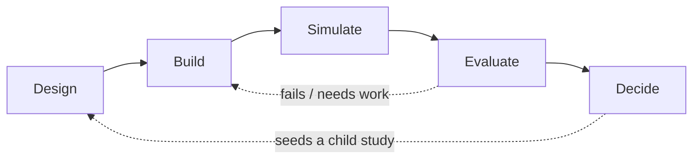

---
tags:
  - study
  - report-card
---

# Studies

!!! quote "The one sentence"
    A **Study** wraps one question, one emit-contract, and one pass/fail bar around a
    [Composite](../compute/composites-and-wiring.md).

A composite is reusable across many questions. A study attaches *one* of those questions
to it: which composite to run, what to measure, and what "passing" means. An
[Investigation](investigations.md) then lets a dozen such questions accumulate into a
defensible claim.

<p class="viva-pull">Separating them means you can re-run the science without rewriting the
argument — and audit the argument without re-reading the code.</p>

A study is **never compiled into a composite of its own.** It stays *metadata that points
at* a composite by a dotted id and reads back what came out: the composite runs, the study
records.

## Three on-disk layers

| Layer | File | What it is |
|---|---|---|
| **Investigation** | `investigations/<slug>/investigation.yaml` | a named collection of studies = a git branch = a worktree |
| **Study** | `studies/<slug>/study.yaml` | one question + its narrative spine (lives **flat** at the workspace root — nesting it under an investigation is a hard L0 audit violation) |
| **Composite** | `viva_<pkg>/composites/<id>.composite.yaml` | the runnable process-bigraph document |

## The five-phase lifecycle

Authoring a study runs through five phases. They are coarsely sequential and iterative in
practice — **Evaluate routinely sends you back to Build.** Each phase *writes a different
part of the study spine*:

| Phase | Produces | Writes to |
|---|---|---|
| **Design** | the spec: question, gate, run set, tests | `purpose`, `pipeline_gate`, `simulation_set`, `behavior_tests`, `readouts` |
| **Build** | executable code: Process classes + composites | `model_change`, `implementation_requirements`, the composite files |
| **Simulate** | the runs: trajectories | `runs.db` |
| **Evaluate** | the verdict: test results + figures | `outcomes`, `visualizations`, `findings` |
| **Decide** | conclusion + follow-ups | `conclusion_verdicts`, discovery implications |



The `phase:` field on a study is a capitalized enum — `Design | Build | Simulate |
Evaluate | Decide`. An investigation card surfaces its *slowest-phase* member, so one
study stuck in Design holds the whole investigation in Design.

??? note "Phases vs the study-detail 'acts'"
    On the study-detail page the same work is grouped into five reading *acts* — **Study**
    (overview) · **Design** (what you author) · **Evidence** (what came back) · **Assurance**
    (what grades it) · **Decision**. The load-bearing boundary there: a **report card
    grades** (→ Assurance › Tests); an **analysis derives** with no verdict (→ Evidence ›
    Analyses). See [Analyses, visualizations & report cards](analyses-visualizations-report-cards.md).

## How a study uses its composite — the five join fields

A study does not rebuild its composite. It *specializes* one through exactly five fields:

<div class="viva-grid" markdown>

<div class="viva-card" markdown>
### 1 · Baselines
`conditions.baseline` — the runnable composite(s). Canonically a single mapping
`{composite, params}`; promoted to a **list of arms** (`{name, composite, params}` each)
it declares a [multi-arm study](#multi-arm-and-planned-studies). A top-level `baseline:`
is the legacy v3 shape the audit **rejects** (`canonical-model-schema`, a hard L0
failure) — it auto-migrates into `conditions.baseline`.
</div>

<div class="viva-card" markdown>
### 2 · Variants
`variants[]` — **parameter overrides only**: `{name, base_composite, parameter_overrides}`.
No structural or initial-state edits; `base_composite` must name an existing baseline entry.
</div>

<div class="viva-card" markdown>
### 3 · Simulation set
`simulation_set[]` — the run recipe (base model, perturbation, condition, seeds, duration).
In v4 it *replaces* the separate v3 `variants:` + `interventions:` lists.
</div>

<div class="viva-card" markdown>
### 4 · Readouts — the emit contract
`readouts[].store_path` — ties a named observable to the **exact emission path** in the
composite's output. This is the contract that says *what the run must emit* to be gradable.
</div>

</div>

<div class="viva-card" markdown>
### 5 · Behavior tests — the verdict
`behavior_tests[]` — a machine-checkable spec: a `measure` (how to extract a number from
run history) plus a `pass_if` (op + value/range). This is what turns a trajectory into a
pass or fail. A test may carry a `variant:` sub-field to scope it to one named variant.
</div>

Running a baseline (`POST /api/study-run-baseline`) resolves the baseline id, **builds
that composite in-process**, merges the params, runs it, and records the trajectory in
`runs.db`. The study itself is never compiled.

## Multi-arm and planned studies

### Multi-arm: `conditions.baseline` as a list of arms

`conditions.baseline` is canonically a single `{composite, params}` mapping. Make it a
**list** and the study becomes **multi-arm** — one question studied across several
distinct-composite arms, each its own `{name, composite, params}`. A typical shape pairs
a **headline** arm with a **matched-null / ablation control** arm — the null that must
*fail* for the headline claim to count — and one or more **alternative / fidelity** arms:

```yaml
conditions:
  baseline:
    - name: headline
      composite: viva_genesis.composites.carbon_fixation.hydrothermal_carbon_fixation
      params: {}
    - name: matched-null                 # the control that must collapse
      composite: viva_genesis.composites.carbon_fixation.no_gradient_no_catalyst
      params: {}
    - name: coarse-grained               # an alternative-fidelity arm
      composite: viva_genesis.composites.carbon_fixation.reduced
      params: {}
```

The list form is first-class in both the reproducibility audit and the Workbench renderer
(the canonical schema types `baseline` as `["object", "array"]`). It is a different
mechanism from a `program: consolidated` study's [`arms:` block](#multi-arm-studies),
which folds several *whole studies* into one evidence record.

### Planned studies — design-only shells

A study can be declared before its models exist. A **planned** study carries
`status: planned` and `phase: Design`, and its baseline arms may legitimately have **no
`composite` yet** — they render as design-only shells. This is a valid state, not a gap to
paper over: **never fabricate a composite to satisfy a check.** The lint and audit
pipelines refuse to let a planned study claim a result (see
[Rigor & evidence](rigor-and-evidence.md)).

## Derive-on-read: verdicts are computed, never asserted

A study's conclusion is **computed from its evidence, not asserted** (see
[Rigor & evidence](rigor-and-evidence.md)). You never write `status: pass` by hand; a
per-test pass/fail pill is derived from the latest run's `outcomes[test].result` in `runs.db`.

The spine keeps **authored** intent and **computed** evidence in *parallel* fields — the
parallel-slot table is in
[Rigor & evidence](rigor-and-evidence.md#the-parallel-slot-convention) — and a
`diverges_from_authored` flag is the dashboard headline when they disagree.

So a test authored `status: passed` but backed by no run outcome renders as a pending
pill (<span class="pill draft">pending</span>), not a pass. A study renders
**Ran · Tests N&check; · Passed** only when `runs[].outcomes` actually back the results.

The rolled-up **gate state** (`study_verdict.roll_up_verdict()`) aggregates outcomes
and prerequisites into a code-computed `gate_status` — passed iff `fail == 0 and
pass > 0`:

<span class="pill pass">passed</span>
<span class="pill fail">failed</span>
<span class="pill draft">needs_calibration</span>
<span class="pill draft">blocked</span>
<span class="pill draft">not_started</span>

This is the mechanical **execution** gate — distinct from the study's scientific
`verdict` (`supported` / `qualified` / `inconclusive` / `refuted`), which a person
authors. It writes a *parallel coded slot* and never overwrites the authored gate.

Because the study is typed data, hardening it — filling gaps, citing bands, tightening a
claim — is a transformation an agent can apply and a human can verify, not a matter of taste.

## The four axes a study tracks

A study separates *where you are*, *whether it ran*, *whether the science holds*, and
*how strong the modeling is* — four independent axes that are easy to conflate and
must not be:

<div class="viva-grid" markdown>

<div class="viva-card" markdown>
### Phase — where you are
`Design → Build → Simulate → Evaluate → Decide`. One value at a time; the `phase:`
field. *Position* in authoring the study.
</div>

<div class="viva-card" markdown>
### Status axes — did it run?
Independent, nullable axes — `design_status`, `simulation_status`,
`evaluation_status`, `gate_status` (some specs add `implementation_status`,
`expert_review_status`). Each has its own enum (`simulation_status: not_run ·
running · ran · failed`; `gate_status: blocked · needs_calibration · passed ·
failed`). The **execution** state — mechanical, not scientific.
</div>

<div class="viva-card" markdown>
### Verdict — does it hold?
The study's **scientific conclusion**: `supported` · `qualified` · `inconclusive` ·
`refuted` (unset renders *pending*, never green). Authored, not mechanical — a study
can have `gate_status: passed` and still be `qualified`.
</div>

<div class="viva-card" markdown>
### Evidence tier — how strong?
The **fidelity** of the modeling behind the verdict: `conceptual_demonstration` →
`mechanistic_prediction` → `calibrated`. A separate axis from the verdict.
</div>

</div>

The last two are the easy mistakes. **Execution status is not a verdict** — "it ran
and the gate passed" is not "the science holds"; that is a separate, authored call.
And **higher fidelity is not stronger evidence**: `evidence_tier` and `verdict` are
orthogonal, so a `calibrated` study can be `refuted` and a `conceptual_demonstration`
can be `supported`. The investigation graph renders exactly this pair as each node's
two marks (see [Investigations](investigations.md#two-marks-per-node-verdict-evidence-tier)).

The status axes are additive — a legacy study with only a coarse `status:` renders
exactly as before.

## The `study.yaml` narrative spine (v4)

A v3 `study.yaml` is organized into **eight canonical sections** plus two cross-cutting
fields. The v4 schema adds a *second layer* of optional **narrative-spine** fields — the
shape the DnaA-replication investigation evolved through use, now promoted to
canonical-optional. A v3 spec validates unchanged against v4; new scaffolds land the v4
fields commented in as TODO placeholders.

**The eight canonical sections:**

| # | Section | YAML field(s) |
|---|---|---|
| 1 | Purpose | `purpose:` (`question` / `mechanism` / `expected_outcome`) |
| 2 | Pipeline Gate | `pipeline_gate:` (`prerequisites` / `enables` / `proceed_condition`) |
| 3 | Simulations | `simulation_set:` (replaces v3 `variants:` + `interventions:`) |
| 4 | Build | `model_change:` + `implementation_requirements:` |
| 5 | Readouts | `readouts:` (replaces v3 `observables:`; each carries `status`) |
| 6 | Tests | `behavior_tests:` (replaces v3 `expected_behavior:`) |
| 7 | Limitations | `limitations:` |
| 8 | References | `bibliography:` |

Cross-cutting: `key_assumptions:` (pairs with Build) and `conclusion_logic:`
(`if_primary_tests_pass:` / `if_primary_tests_fail:`, pairs with Tests).

**The v4 narrative spine, four layers** (all optional; the six ★ fields are authored first
and render at the top of the report):

- **Executive** — `title`, `claim`, `confidence` (`Accepted | Investigating | Planned |
  Refuted`), `runtime`, **★ `report:`** (verdict / confidence / evidence_quality /
  key_metrics), **★ `study_card:`** (one-paragraph card).
- **Framing** — **★ `question:`** + `assumptions:`, **★ `conditions:`** (the canonical
  model declaration — `{baseline, variants, model_settings}`, which supersedes the legacy
  top-level `baseline:` + `variants:` that the L0 audit now rejects; its `model_settings[]`
  is the source of truth for tunable parameters — current value + default + literature
  range + cite), `enforced_params:` (values each run is *required* to apply).
- **Validation** — **★ `behavior_tests:`**, **★ `readouts:`** (`store_path` = the emit
  contract), `biological_summary:` (textbook prose), `literature_anchors:`.
- **Implementation + decisions** — `model_change`, `implementation_requirements`,
  `design_pivot_required:` (open decision points), **★ `conclusion_verdicts:`** — a
  three-track block `{regression_compatibility, biological_validation, explanatory_gain}`,
  each `{result, basis}`, so a study can be "PASS on regression but MIXED on biology"
  instead of one forced boolean.

??? warning "Accuracy note — the schema version is in flux"
    Study specs exist as **v2 → v3 → v4**, migrated on load. This chapter presents **v4**;
    the `schema_version:` field selects the shape (and, at v4, the presence of a top-level
    `conditions:` block disambiguates two v4 variants). Set `schema_version: 4` to opt into
    the v4 reserved field names. A handful of names are **reserved** at v4 and were renamed
    from v3 to avoid collisions — `references:` → `bibliography:`, `tests:` is reserved (so
    the field is `behavior_tests:`). When in doubt, read a live `study.yaml` in a real
    workspace rather than inventing a field.

### A realistic `study.yaml` skeleton

Faithful to the shipped shape; values truncated to placeholders.

```yaml
schema_version: 4
name: dnaa-01-expression-dynamics       # the slug is the technical id
title: DnaA expression dynamics          # human display name (v4 spine)
created: '2026-08-14'
phase: Evaluate                          # Design | Build | Simulate | Evaluate | Decide

# --- six independent status axes (replace the coarse `status:`) ---
design_status: approved
implementation_status: complete
simulation_status: ran
evaluation_status: evaluated
gate_status: needs_calibration
expert_review_status: requested

# 1 · PURPOSE
purpose:
  question: |
    Does DnaA-ATP fraction cycle within its literature band across generations?
  mechanism: |
    Titration of DnaA by datA and the chromosomal DnaA boxes.
  expected_outcome: |
    DnaA-ATP fraction stays within 0.2-0.5, oscillating once per division.

# 2 · PIPELINE GATE
pipeline_gate:
  prerequisites: []                      # parent study slugs (bare slug or {study, condition})
  enables: [dnaa-02-initiation]
  proceed_condition: tests-passed

# FRAMING · conditions = the model declaration (NOT the run recipe)
# conditions: declares baseline + variants + tunables; simulation_set: (canonical
# section 3, auto-derived) is the separate run set that actually schedules the runs.
conditions:
  baseline:                              # canonical single mapping {composite, params}
    composite: v2ecoli.composites.baseline.baseline
    params: {}
  variants:
    - name: high-datA
      base_composite: baseline
      parameter_overrides: { datA_copies: 2 }
  model_settings:
    - name: dnaa_synthesis_rate
      current: 0.85
      default: 1.0
      range: [0.5, 1.5]
      units: 1/s
      cites: [Hansen2018]

# 4 · BUILD
model_change:
  - kind: change_config
    path: processes.dnaa
implementation_requirements: []

# 5 · READOUTS  (the emit contract)
readouts:
  - name: dnaa_atp_fraction
    store_path: listeners.dnaa.atp_fraction
    status: available
    units: dimensionless

# 6 · TESTS  (measure + pass_if -> the verdict)
behavior_tests:
  - name: atp-fraction-in-band
    classification: primary
    measure:
      kind: generation_average           # the discriminating sub-key is `kind`
      path: listeners.dnaa.atp_fraction
    pass_if: { op: in_range_every_generation, low: 0.2, high: 0.5 }
    cites: [Boesen2024]

conclusion_logic:
  if_primary_tests_pass: |
    DnaA titration reproduces the observed cycling band.
  if_primary_tests_fail: |
    Revisit the datA titration parameters before advancing.

# --- v4 executive spine (authored last, renders first) ---
report:
  verdict: passing-with-caveats          # free-form; computed acceptance sits alongside
  confidence: medium
  evidence_quality: literature-matched
  key_metrics: [dnaa_atp_fraction]
conclusion_verdicts:
  regression_compatibility: { result: PASS, basis: "matches v1 baseline" }
  biological_validation:    { result: MIXED, basis: "band met in 6/7 generations" }
  explanatory_gain:         { result: POSITIVE, basis: "resolves initiation timing" }

# 7 · LIMITATIONS
limitations: |
  Single-seed; ensemble replication pending.

# 8 · REFERENCES
bibliography:
  - Boesen2024
  - Hansen2018

# provenance — outcomes are written by the run, never by hand
runs: []                                 # {run_id, outcomes{...}} — filled from runs.db
findings: []
```

??? note "You author fields; you do not author verdicts"
    The `runs[].outcomes`, `computed_outcomes`, the rolled-up gate verdict, and the
    per-finding `evidence`/`provenance` slots are all **derive-on-read**: code fills them
    from the latest run in `runs.db`. Your job is the *authored* side — the question, the
    tests, the bands, the prose. See [Rigor & evidence](rigor-and-evidence.md) for how the
    computed side is graded.

## Multi-arm studies

A study can fold several related studies or conditions into one, as **arms**. A
consolidated study (`program: consolidated`) carries a top-level `verdict` and
`evidence_tier` for the whole, and an `arms:` list in which each arm is a folded
study/condition with its *own* verdict, fidelity, gate, and evidence:

```yaml
program: consolidated
verdict: supported                     # the study's rolled-up conclusion
evidence_tier: mechanistic_prediction
plan_id: 1                             # the gate this study answers (see Investigations)
arms:
  - id: 01_geology_to_reduced_carbon
    source_study: og-01-geology-to-reduced-carbon
    concept_role: "Canonical: H2-driven CO2 reduction reproduces the Preiner-2020 hierarchy."
    fidelity: mechanistic_prediction
    verdict: supported
    gate_status: passed
    matched_null: controls-collapse-no-gradient-no-H2-no-catalyst
    composite: viva_genesis.composites.carbon_fixation.hydrothermal_carbon_fixation
    run_ids: [ "...__1792066785__b9f82a" ]
    finding_ids: [ og01-preiner-yields, og01-gradient-drives-formate ]
    canonical: true
  - id: 01_cal_dx_label_disagreement
    source_study: og-01-cal-dx-label-disagreement
    status: planned                    # a proposed arm, not yet run
    fidelity: null
    verdict: null
    note: "Planned diagnostic: why do empirical and Butler-Volmer classes disagree?"
    seeded_from: { study: og-01-cal-electrochemistry }
```

Each completed arm pins:

- its **own `verdict` and `fidelity`** — so a study can be `supported` overall while
  one arm is `refuted` on a secondary question;
- a **`matched_null`** — the null that must *fail* for the arm's claim to count (e.g.
  "controls collapse with no gradient, no H2, no catalyst"). An arm's verdict means
  nothing unless its claim out-performs that null;
- the **`composite`** it ran, and the **`run_ids`** / **`finding_ids`** that back it;
- **`canonical: true`** on the one arm that defines the study's headline claim.

A **planned** arm carries `status: planned`, null `verdict`/`fidelity`, a `note`, and
`seeded_from` — a proposal recorded in place, not a result. The lint pipeline refuses
to let a planned arm, or an unconfirmed matched-null, masquerade as a pass (see
[Rigor & the evidence engine](rigor-and-evidence.md)).

!!! note "Not every study carries every section"
    The eight authoring sections above describe a study being *designed*. A
    consolidated, arms-based study is an *evidence record*: it carries the top-level
    `verdict`/`evidence_tier`, `arms`, `behavior_tests`, `findings`, and `runs`, and
    typically drops the design-time scaffolding (`pipeline_gate`, `simulation_set`,
    `model_change`). Read a live `study.yaml` to see which profile you are in.

## Where studies fit

- Build the composite a study runs → [Composites & wiring](../compute/composites-and-wiring.md).
- Grade the runs, render figures and report cards → [Analyses, visualizations & report cards](analyses-visualizations-report-cards.md).
- Group studies into a gated argument → [Investigations](investigations.md).

---

**Next:** [Analyses, visualizations & report cards](analyses-visualizations-report-cards.md)
